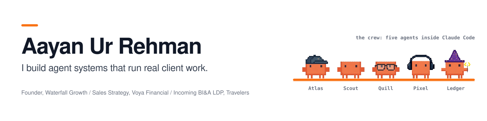
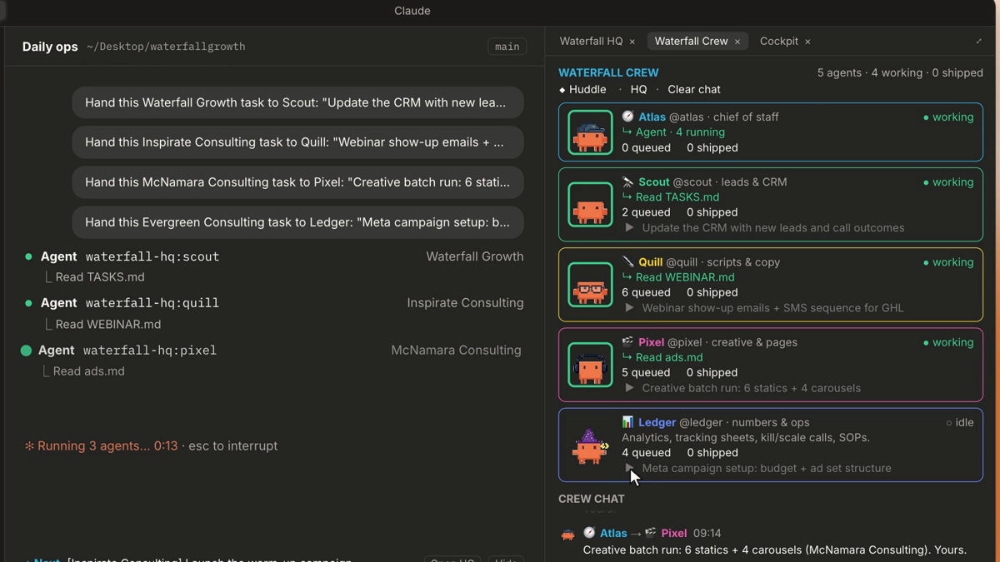
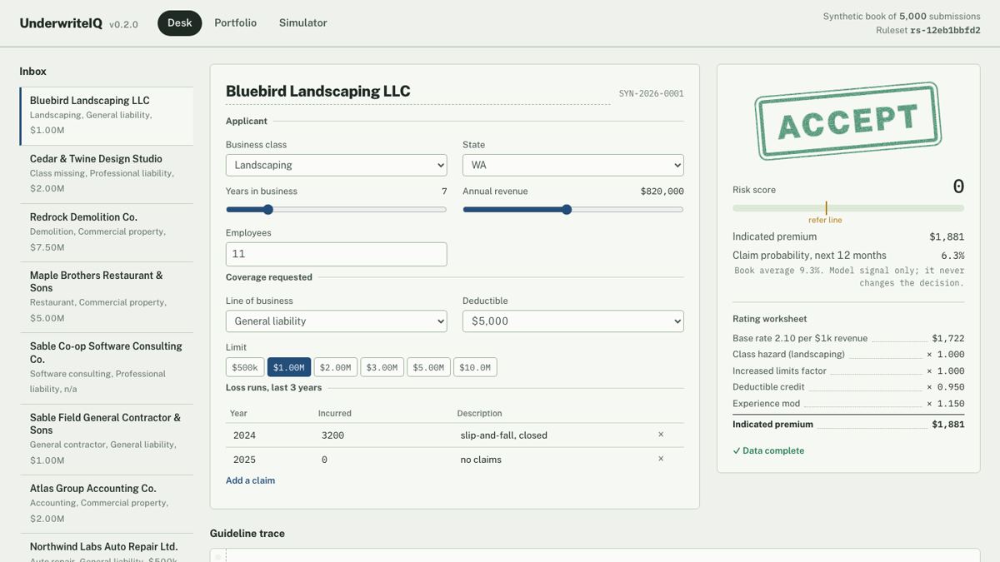
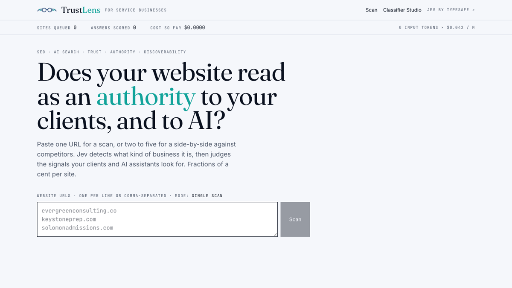
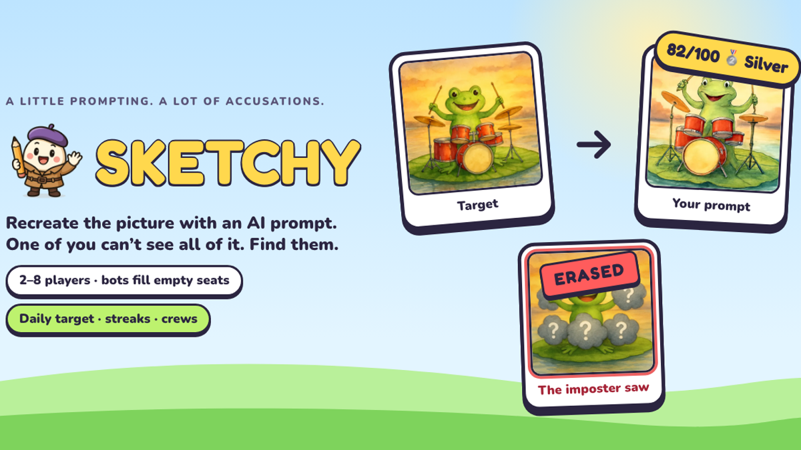

<picture>
  <source media="(prefers-color-scheme: dark)" srcset="assets/banner-dark.svg">
  
</picture>

  
  
  

I build AI systems that do real work for real businesses. That means agent teams inside Claude Code, underwriting engines, and GTM pipelines. I run them on my own clients first.

My rule for putting AI into decisions that matter: **the model drafts, code decides, and tests prove it.** Deterministic logic owns the outcome, the model explains it or makes one narrow, typed judgment, and every build ships with tests, evals and CI.

**Now**
- 🏗️ **Founder, Waterfall Growth.** Growth systems for independent educational consultants: paid acquisition, funnels, CRM and agent-run ops, built in Claude Code.
- 📈 **Sales Strategy Intern, Voya Financial.** Mapping and automating processes, and building agents for the retirement sales team.
- 📊 **Incoming Business Intelligence & Analytics LDP Intern, Travelers.**
- 🎓 Studying management information systems and business analytics. AINS (Associate in Insurance) · AWS Certified AI Practitioner.

## Featured

<table>
<tr>
<td width="50%" valign="top">

<h3><a href="https://github.com/aayanrehman/crew-hq">Crew HQ</a></h3>
A team of five AI agents that lives inside Claude Code. ▶ any task in your <code>TASKS.md</code> files and it becomes a subagent run. The agents huddle in their own chat, report back, and tick the box themselves. Ships with a setup skill plus cost-cockpit, done-chime and seatbelt mods.
  
<code>TypeScript</code> <code>Claude Code mods</code> <code>subagents</code> <code>Haiku</code>
</td>
<td width="50%" valign="top">

<h3><a href="https://github.com/aayanrehman/underwriteiq">UnderwriteIQ</a></h3>
A commercial underwriting simulator. Versioned guideline rules, a rating worksheet and a numpy loss model run over a 5,000-risk synthetic book with hidden claims. A what-if simulator re-underwrites the book in 20 ms. Claude writes the memo and guardrails verify it. 46 tests, 93% coverage.
  
<code>Python</code> <code>FastAPI</code> <code>SQL</code> <code>numpy</code> <code>Claude API</code>
</td>
</tr>
<tr>
<td width="50%" valign="top">

<h3><a href="https://github.com/aayanrehman/trustlens">TrustLens</a> · <a href="https://trustlens-mauve.vercel.app">live</a></h3>
A trust and AI-visibility auditor for service businesses. 90% of the audit is deterministic extraction; four typed judgments go to a calibrated model that never sees HTML. You get a grade, five scores and a fix-it plan, for about $0.00016 per site.
  
<code>Next.js</code> <code>Convex</code> <code>TypeSafe Jev</code> <code>Vercel</code>
</td>
<td width="50%" valign="top">

<h3><a href="https://github.com/aayanrehman/sketchy">Sketchy</a> · <a href="https://sketchy-blue.vercel.app">play</a></h3>
A party game for 2–8 players. Everyone recreates a target image with AI prompts, but one player sees a doctored copy. The AI judge scores the drafts, drops hints, and the table votes out the imposter.
  
<code>TypeScript</code> <code>Convex</code> <code>image generation</code> <code>realtime</code>
</td>
</tr>
</table>

**More builds**

| | |
|---|---|
| [**CaseSprint AI**](https://github.com/aayanrehman/casesprint-ai) | Case-competition copilot: research plan, MECE issue tree, storyline and timed speaker scripts. Deterministic Python core with an agent layer on top. CI-tested. |
| [**Presales Agent**](https://github.com/aayanrehman/Presales-Agent) | Turns RFPs, SOWs and discovery notes into scope, a RAID matrix, a QA and staffing plan, a Word brief and a pitch deck, using gated multi-agent prompts. |
| [**OpenClaw Agent**](https://github.com/aayanrehman/openclaw-agent) | Autonomous lead follow-up for real estate agents over SMS and Instagram/Facebook DMs, with every action logged to a live dashboard. |
| [**Evergreen lead gen**](https://github.com/aayanrehman/evergreen-lead-gen) | An ad research-to-launch workflow for a client: launch walkthrough page and media-buying guide. |

## Toolbox

Agents and subagents · Claude Code mods and skills · evals and guardrails · RAG · deterministic rule engines · GTM systems

---

Building in public on <a href="https://www.linkedin.com/in/aayanurrehman/">LinkedIn</a>. If something here is useful to you, I'd love to hear what you'd build with it.
